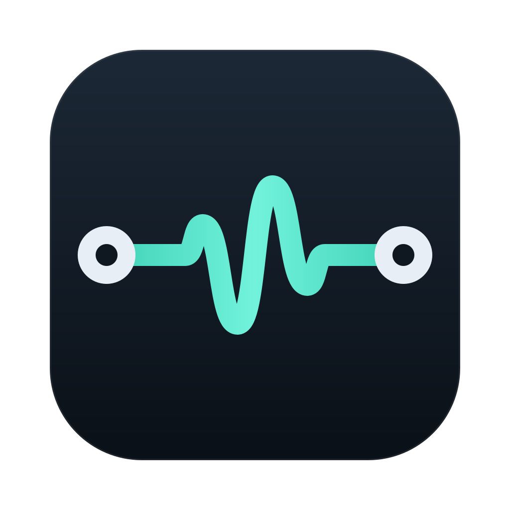

<p align="center"></p>

# Tightwire

Tightwire sends one audio input from a Mac (a microphone, an audio
interface, or a Wave Link mix) to a Windows PC on the same wired network,
uncompressed and with a few milliseconds of buffering, so the PC can use it
as a live microphone. It can also move a USB device such as a Stream Deck
between the two computers with a button press.

It is a small two-part tool: a menu bar app on the Mac and a tray app on the
PC. It is early software (0.x) written for one desk setup and now published
in case it helps others; read [Limitations](#limitations) before relying on
it.

- **Audio:** 32-bit float PCM over UDP, 1 ms packets, an adaptive jitter
  buffer and continuous clock-drift resampling on the PC, WASAPI output
  (shared mode; exclusive mode optional). Mono or stereo.
- **Pairing:** a one-time six-digit code confirmed on both screens; after
  that every packet is authenticated, and the Mac only sends while the
  paired PC proves it is listening.
- **Stream Deck handoff (optional):** moves chosen USB devices to the PC over
  USB/IP using [Longcable](https://github.com/Sapd/longcable) on the Mac and
  [usbip-win2](https://github.com/vadimgrn/usbip-win2) on the PC, and takes
  them back when the PC goes away.

Design and wire protocol: [SPEC.md](SPEC.md). Changes: [CHANGELOG.md](CHANGELOG.md).

## What you need

| | Mac | PC |
|---|---|---|
| System | macOS 14 or later, Apple silicon | 64-bit Windows 10 or 11 |
| To build it | [Xcode](https://apps.apple.com/app/xcode/id497799835) 27 and [mise](https://mise.jdx.dev/getting-started.html) | nothing extra if you cross-build on the Mac; otherwise Rust and the Visual Studio C++ Build Tools (below) |
| Audio | any input device CoreAudio sees | a virtual playback endpoint for Tightwire to play into: an Elgato Wave Link channel, or [VB-Audio Virtual Cable](https://vb-audio.com/Cable/) |
| Network | the same LAN as the PC; wired Ethernet for the advertised latency | same |
| Stream Deck handoff | administrator password once (installs Longcable's background service) | [usbip-win2](https://github.com/vadimgrn/usbip-win2) (the installer offers it through `winget`) |

## Build and install

There are no downloads: you build both halves from this repository. It
needs no developer account or signing certificate; the only account involved
is the Apple Account the App Store asks for to install Xcode.

### Mac

1. Install **Xcode 27** and open it once so it finishes installing its
   components. The Command Line Tools alone are not enough: the app's
   SwiftUI code needs macros that only ship with Xcode. If `xcode-select -p`
   prints `/Library/Developer/CommandLineTools`, run
   `sudo xcode-select -s /Applications/Xcode.app`.
2. Install [mise](https://mise.jdx.dev/getting-started.html); it fetches
   Rust and the other build tools for this project only.
3. Build:

   ```sh
   git clone --recurse-submodules https://github.com/thesammykins/tightwire.git
   cd tightwire
   mise trust
   mise install
   mise run package-mac
   ```

   This makes `dist/Tightwire.dmg` (and `dist/Tightwire.app`), ad-hoc
   signed. The first build takes several minutes.
4. Open `dist/Tightwire.dmg`, drag **Tightwire** to Applications and open
   it. A waveform icon appears in the menu bar and the Tightwire window
   opens on **Setup**, which lists what is left to do:
   - *Microphone access*: Allow.
   - *Paired with a PC*: see [Pairing](#pairing).
   - *Stream Deck handoff helper* (optional): Install… asks for your
     administrator password.
   - *Open at login*: on.

**Gatekeeper.** An app you built on the same Mac opens without a warning,
because macOS only checks apps that arrived from a browser, AirDrop or a
chat (quarantined files). If you copy the dmg to another Mac that way,
macOS refuses it as from an unidentified developer: it is ad-hoc signed and
not notarized. Allow it under System Settings › Privacy & Security › Open
Anyway, or build it on that Mac.

**After each rebuild.** An ad-hoc signature identifies the app by a hash of
its exact code, so every rebuild is a new app to macOS's privacy and
Keychain checks. Expect it to ask for microphone (and local network) access
again, and for the Keychain to ask whether Tightwire may read "Tightwire
pairing" (choose Always Allow; if you deny it, pair again). If your keychain
holds a "Developer ID Application" identity, `package-mac` signs with it
instead, and those prompts stay away across rebuilds.

### PC

Pick one of two ways to get `Tightwire-Windows`, the folder with
`tightwire.exe` and its installer.

**A. Cross-build on the Mac** (nothing to install on the PC). In the
`tightwire` folder from above:

```sh
mise run package-windows
```

Copy `dist/Tightwire-Windows.zip` to the PC and unzip it.

**B. Build on the PC.**

1. Install Rust and the Visual Studio C++ Build Tools (about 3 GB), in a
   terminal:

   ```powershell
   winget install --id Rustlang.Rustup -e
   winget install --id Microsoft.VisualStudio.2022.BuildTools -e --override "--passive --wait --add Microsoft.VisualStudio.Workload.VCTools --includeRecommended"
   ```
2. Get the source: `git clone https://github.com/thesammykins/tightwire.git`,
   or **Code › Download ZIP** on GitHub and unzip it (the PC does not need
   the Longcable submodule).
3. Double-click `windows\Build Tightwire.cmd` in that folder. It checks for
   Rust and the build tools (and says exactly what is missing), runs
   `cargo build --release` and writes `dist\Tightwire-Windows`.

**Then, either way:** double-click **Install Tightwire.cmd** in
`Tightwire-Windows` and approve the administrator prompt; it is needed once,
for the firewall rule. The installer copies Tightwire to
`%LOCALAPPDATA%\Programs\Tightwire`, offers to install usbip-win2, adds a
Start menu entry and starts the tray app.

The firewall rule (**Tightwire (UDP)**: UDP 4810 and 4814 from the local
subnet) applies to **Private and Domain networks only**. If Windows treats
your home network as *Public*, Tightwire hears nothing: set it to Private
(Settings › Network › your connection › Private network).

`tightwire.exe` is **not code-signed**. A build made on the PC runs without
a prompt; if the files reached the PC through a browser, email or chat,
SmartScreen may say "Windows protected your PC": choose **More info › Run
anyway** for a build you made yourself. Re-running the installer upgrades in
place; uninstall from Settings › Apps or with `Uninstall Tightwire.cmd` in
the install folder.

**Build the Mac and the PC from the same checkout.** Stream Deck handoff,
latency measurement and buffer tuning need 0.2.0 on both sides.

## Pairing

1. PC: right-click the Tightwire tray icon › **Pair…**.
2. Mac: Tightwire window › **Receiver** › **Pair with a PC…**, then **Pair**
   next to the PC.
3. Both screens show a six-digit code. Confirm on both only if they match.

Then choose the PC's output: tray icon › **Output device** (next section),
and on the Mac pick the input and channel in **Stream** and press **Start**.

- **Input:** your saved choice, else the system default input. A device with
  two or more channels is sent as stereo (all channels) unless you pick one
  mono channel; the choice is kept per device.
- **Menu bar icon:** a plain waveform when idle, a hollow ring while looking
  for the PC, a red dot while the PC is receiving, a yellow "!" when the PC
  receives but has no output open ("PC is not playing: choose an output on
  the PC"), an orange "!" on an error.
- **Stream pane:** the PC's buffer depth, drift, loss, the input level and a
  latency breakdown ([Latency](#latency)), plus a warning when the PC's
  output is not keeping time (drift correction at its limit, underruns
  climbing, or exclusive mode given up).
- **Sleep:** while streaming, or while a Stream Deck is on the PC, the Mac
  does not idle-sleep (the display still does). `pmset -g assertions` lists
  it as "Tightwire: streaming to …".

## Choosing the PC's output

Tightwire plays into **the one output endpoint you choose** and never into
anything else; until you choose, it opens no output and discards the audio.
Pick a dedicated virtual endpoint, not speakers or headphones: whatever plays
into it is what Windows apps hear as the microphone.

- **Wave Link:** add a channel for Tightwire in Wave Link. Its Windows
  playback endpoint is named `<channel name> (Elgato Virtual Audio)`. Apps
  hear it through Wave Link's mix, i.e. whichever Wave Link microphone or mix
  they record from.
- **VB-Cable:** choose **CABLE Input** as Tightwire's output and select
  **CABLE Output** as the microphone in your apps. Expect a few ms more
  latency from the cable driver.

**Shared mode** is the default: Tightwire asks for the smallest period the
driver offers (and logs the driver's range) and keeps only about one period
queued in the endpoint. Some drivers offer nothing shorter than 10 ms in
shared mode (Elgato Virtual Audio among them).

**Exclusive mode** (tray menu › Exclusive mode, per device; off unless you
turn it on) can reach the driver's shortest period and keeps other apps from
playing into the endpoint. It is **experimental for virtual devices**: one
virtual endpoint accepted it and then delivered its buffers in bursts at an
off-nominal rate, while shared mode on the same endpoint was fine. If an
exclusive stream keeps underrunning, or the drift correction stays at its
limit, for about 10 s, Tightwire reopens the endpoint in shared mode, shows
a notification, logs why, and leaves exclusive mode off for that endpoint
until you turn it on again. An endpoint that refuses exclusive mode is used
in shared mode with a log line. Any sample rate works (the stream is
resampled).

Only one Tightwire tray runs per Windows session; starting it again says it
is already running.

## Stream Deck handoff

**Pair first, then install the helper.** Setup offers *Stream Deck handoff
helper* only once a PC is paired, and installs Longcable with exactly that
PC's address on its allow-list (never Longcable's subnet or tailnet
default). If the allow-list already holds anything wider than single
addresses (a subnet, `100.64.0.0/10`, `any`), the Stream Deck pane warns and
offers **Allow Only <PC>**.

Tick the devices to hand over in the Tightwire window › **Stream Deck**
(suggested devices are listed first; the audio interface you stream from
cannot be ticked, and keyboards, mice, storage, audio and camera devices ask
first). Then:

- While the PC answers, ticked devices go to the PC; 5 s after it stops
  answering they come back to the Mac. **Back to Mac** holds them on the Mac
  until **Send to PC**. Quitting Tightwire always takes them back.
- Buttons: on the Mac, a Stream Deck "Website"/Open URL action with
  `tightwire://deck/pc`, `tightwire://deck/mac` or `tightwire://deck/toggle`;
  on the PC, a Stream Deck "Open" action running
  `"%LOCALAPPDATA%\Programs\Tightwire\tightwire.exe" deck pc` (or `mac`,
  `toggle`). Mac URL buttons are **off by default**, because any app or web
  page can open a URL: the first one asks once, and **Allow URL buttons** in
  the Stream Deck pane switches them.
- If the PC's attach fails because the Mac's Stream Deck app holds the
  device, Tightwire can quit that app, retry once and reopen it when the
  device comes back (on by default for Elgato devices).
- The Mac connects nothing: the PC connects out to the Mac on TCP 3240. If
  the Mac's firewall is on, allow incoming connections for `longcable-server`.

## Logs and diagnostics

Mac menu › **Open Log** (`~/Library/Logs/Tightwire/tightwire.log`); PC tray ›
**Open log**. Both logs start every run with the version and build, e.g.
`Tightwire 0.2.0 (abc1234567)`, which the tray menu's first line and the
Mac's Setup › Diagnostics also show. While streaming, each side writes one
stats line every 10 s (buffer, target, jitter, loss, underruns, drift and,
on the Mac, round trip; on the PC also what the output device does), so a
long session can be read back afterwards.

`tightwire.exe doctor` on the PC checks pairing, the chosen output, the
firewall rule, usbip-win2 and the TCP path to the Mac.

## Latency

The design budget on a wired LAN at 48 kHz is about **6–9 ms** from the Mac's
input to the PC's output device: about 1 ms of capture buffer, under 0.5 ms
of network, a jitter buffer of a few ms and about 3 ms of WASAPI
exclusive-mode period. Shared mode (10 ms or more on Elgato Virtual Audio),
VB-Cable and Wave Link add their own latency on top; of that, Tightwire sees
only what is queued in the PC's output endpoint, which the PC reports and
the Stream pane lists as "PC output queue". On Wi-Fi, use larger packets (128–256 frames in the Stream
pane) and expect a deeper buffer.

While streaming, the Stream pane lists where the time goes and labels each
line: **measured** (network, half the probe round trip; the PC's live buffer
depth), **reported** by a driver (Core Audio's input latency), **fixed** by
configuration (packet size, the resampler's filter) or an **estimate** (one
output period on the PC). The total is an estimate.

**Run Latency Test** (30 s, needs a 0.2.0 PC) sends a timestamped marker
packet once a second; the PC reports when that audio left for its output
device, and the Mac converts the time to its own clock. The result is a
**measured** Core Audio capture → PC output device time with an error bound
(half the best round trip plus the clock-fit residual). It does not include
the drivers' own latencies or the output period. The test also recommends a
packet size and a buffer floor and cap; **Apply** sends them to the PC, which
keeps them.

So far this has been measured only on one Mac over localhost (the loopback
test, sender and receiver on the same machine): capture → output about
3 ms with a ~2.6–3.5 ms buffer. **No measurement between two real machines
exists yet.**

## Clock drift

The Mac's and the PC's audio clocks never run at exactly the same speed
(typically tens of ppm apart, a few milliseconds per minute). The PC does not
drop or repeat samples: it nudges its resampling ratio so its buffer stays at
the target, by at most ±0.1 % (1.7 cents) beyond the output device's own
measured rate, which it follows up to ±1 % (some virtual devices run several
thousand ppm off nominal; following them keeps the pitch right). The `drift`
figure in the Stream pane and both logs is the correction in ppm. Apps on
the PC see a continuous stream at the output device's own rate, with no
gaps, clicks or slow latency creep. After a disturbance that leaves the
buffer far from its target (an output stall, a burst of late packets), the
PC fades out, skips or inserts the difference once, and fades back in: a
dip of about a millisecond instead of seconds of extra latency.

## Security model

- **LAN only, by design.** There is no relay, no cloud service and no NAT
  traversal. The Windows installer's firewall rule allows UDP 4810 and 4814
  only from the local subnet, on Private and Domain networks.
- **Audio is authenticated, not encrypted.** Pairing derives a shared key
  (X25519, confirmed by the six-digit code); every packet carries a SipHash
  tag, and replays are rejected. Anyone on your network can see the audio
  packets, but only the paired Mac can feed the PC. The Mac changes where it
  streams only when the PC signs its own address inside an authenticated
  packet and that matches where the packet came from.
- **Pairing.** The code is shown first and on its own; the other side's
  name follows, quoted, and names with control or invisible formatting
  characters, or over 40 characters, are refused. If two machines announce
  the same PC, both are listed and flagged. Someone on your LAN can disrupt
  a pairing attempt (start it again), but cannot complete one without the
  code matching on both screens.
- **Stored keys.** On the Mac the pairing key is in the Keychain. On Windows
  it is encrypted with DPAPI (readable only by the same Windows user); 0.1.x
  files are converted on the next save.
- **USB/IP is unauthenticated and unencrypted.** That is how the protocol
  works, in Longcable and in usbip-win2. While a device is shared, any
  computer that Longcable's allow-list admits can import it and see
  everything it sends. Tightwire keeps devices unshared except during a
  handover. For each handover it lists the paired PC's exact address (a
  subnet that happens to contain it does not count), removes it again when
  the devices come back if Tightwire added it, and removes the old address
  when the PC's address changes. The allow-list is IP-based, so a device on
  your LAN that can spoof the PC's address could import a shared device. Do
  not use handoff on networks you do not trust.
- **Handoff requests.** The PC attaches USB devices only from the Mac
  address signed inside the request, and only when the request also came
  from there; each request is honoured once.
- **Root helper.** Longcable runs as a root launchd service
  (`org.sapd.longcable`). Tightwire talks to it only through its local
  control socket. The only things it runs as root are Longcable's own install
  and uninstall scripts, through the standard macOS administrator prompt, and
  never from the app in place: the app is copied to a root-only temporary
  folder, the copy is checked against the running app's own code signature,
  and the script runs from the copy with a clean environment.
- **URL scheme.** `tightwire://deck/…` links can be opened by any app or web
  page, so they do nothing until you allow them. Once allowed, the worst
  they can do is move the ticked devices between your own Mac and paired PC.
- **Known gaps, by design or not yet fixed:** audio is not encrypted; a
  stats packet replayed by someone on your LAN can keep the Mac sending for
  up to about 3 s after the PC really went away.

To report a vulnerability, see [SECURITY.md](SECURITY.md).

## Limitations

- One sender, one receiver, one stream; Mac → PC only.
- Apple silicon Macs only; Intel Macs have not been tried.
- Tested so far on one desk: 0.1.1 streamed and handed a Stream Deck over
  between one Mac and one PC. Everything Windows-side that is new in 0.2.0
  (DPAPI key storage, the firewall profile change, buffer tuning, shared-mode
  period reporting) is compiled, linted and unit-tested but has not run on a
  real PC; neither has latency between two real machines been measured. See
  [docs/development.md](docs/development.md#what-is-untested).
- A single network stall of a few ms after a quiet minute can cause one
  dropout (the adaptive buffer has shrunk by then). If the latency test
  reports underruns, apply the floor it recommends.
- Nothing is signed by a recognised publisher: the Mac app is ad-hoc
  signed and the Windows exe unsigned (see [Build and install](#build-and-install)).

## Building, contributing, licence

Tests, development tasks and project layout: [CONTRIBUTING.md](CONTRIBUTING.md)
and [docs/development.md](docs/development.md).

Tightwire is free software under the
[GNU General Public License v3.0 or later](LICENSE). The Mac app includes
Longcable (GPL-3.0-or-later, built unmodified from the `vendor/longcable`
submodule); [THIRD-PARTY-NOTICES.txt](THIRD-PARTY-NOTICES.txt), which every
build carries next to the licence, lists every bundled component and its
licence.

Tightwire is an independent project. It is not affiliated with, endorsed by
or sponsored by Elgato or Corsair. Elgato, Stream Deck, Wave Link and Corsair
are trademarks of their respective owners and are used here only to describe
compatibility.
